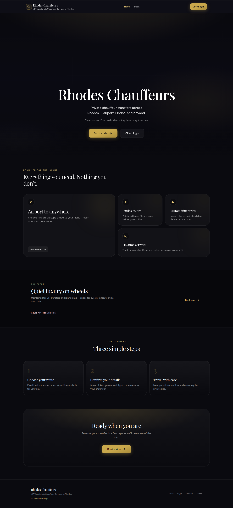
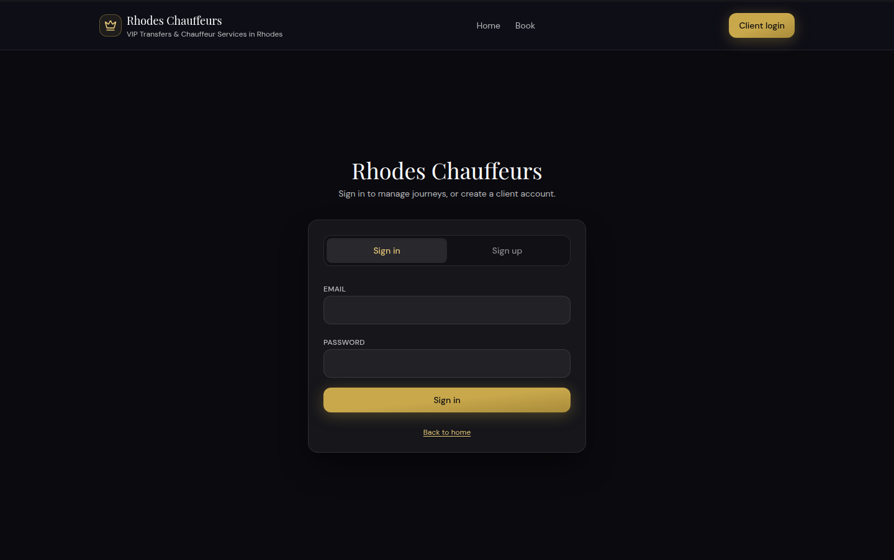
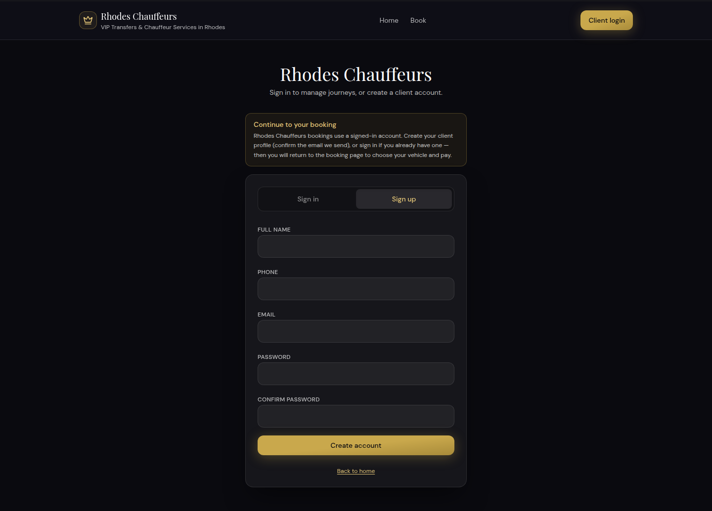
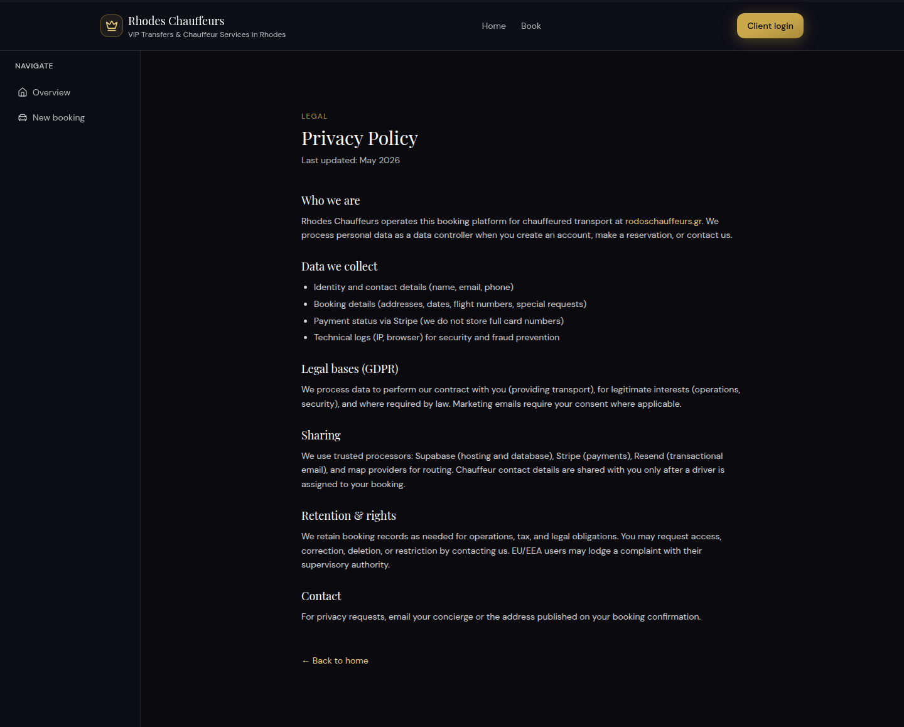
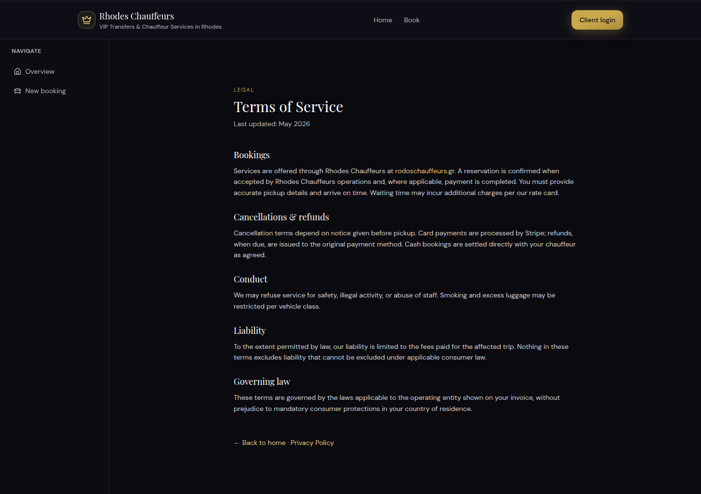
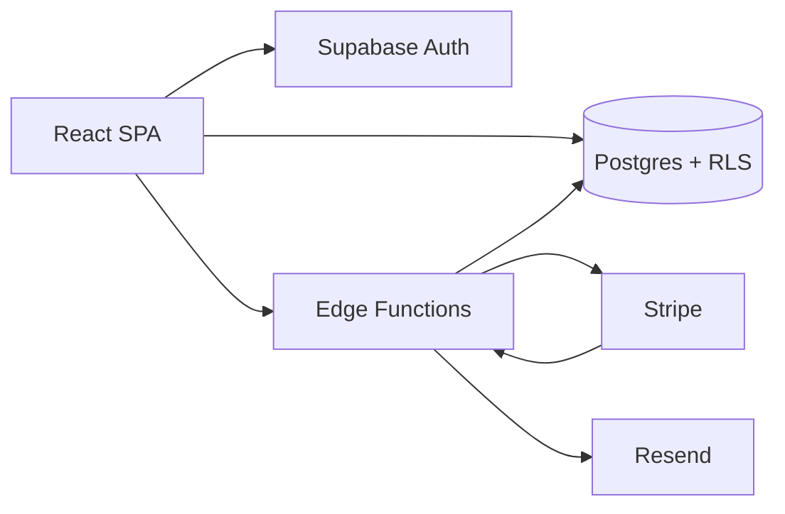

# Rhodes Chauffeurs

Private chauffeur transfers across Rhodes — airport pickups, fixed routes from Lindos, and custom itineraries, booked in the browser.

Presented on [Dimitris Vogiatzis’ portfolio](https://portfolionew-nine-woad.vercel.app/). Live site: [rodoschauffeurs.gr](https://rodoschauffeurs.gr).

## Screenshots

Captured from the production site ([www.rodoschauffeurs.gr](https://www.rodoschauffeurs.gr)). The home page loads fleet cards from Supabase; in this capture that request did not resolve, so the fleet section shows “Could not load vehicles.” Signed-in screens (the booking wizard, client dashboard, and admin console) are not included.



*Home — hero, island services, fleet, and the three booking steps.*



*Client login.*



*`/book` requires an account. Signed-out visitors land on sign-up and return to the wizard after they continue.*



*Privacy policy.*



*Terms of service.*

## Features

**Public site**

- Landing page with the service pitch, a fleet showcase of vehicles marked available, and links into booking.
- Email and password sign-up and sign-in through Supabase Auth, including email-confirmation links.
- Privacy policy, terms of service, and a cookie notice for the session and booking draft stored in the browser.

**Booking**

- Three steps: journey, contact, checkout. The wizard draft is kept in the browser and cleared on sign-out.
- Fixed routes from Lindos with passenger-tier prices (1–4 and 5–8 guests), either per trip or per hour. Up to 6 guests.
- Custom itineraries are cash to the chauffeur. Confirming one calls `confirm_booking_cash`.
- Priced routes can also be reserved as cash. The “Pay with card” control is on the page but disabled (`CARD_CHECKOUT_ENABLED` is `false` in the checkout and confirmation screens). Stripe Checkout and the webhook still exist as Edge Functions for when that switch is turned on.
- Pickup times are checked against scheduling rules before a booking is saved. Clients can cancel a pending booking from the dashboard when the policy allows it.

**Client dashboard** (`/dashboard`, role `client`)

- List of that user’s bookings, including the assigned chauffeur’s contact once a driver is assigned.
- Profile update and password change.

**Admin console** (`/admin`, role `admin`, Greek UI)

- Day and month counts: today’s bookings, revenue this month, active rides, and bookings still waiting for a driver.
- Booking table with filters, status changes, driver and vehicle assignment, PDF export, and Resend emails (ride confirmed, cancellation).
- Route prices, the landing-page fleet (including photo upload), and the driver roster.
- Booking list updates over a Supabase Realtime channel.

`profiles.role` may be `client`, `admin`, or `driver`. Only client and admin have screens. Chauffeurs assigned to trips come from the `company_drivers` roster.

## Tech stack

| Layer | What the repo uses |
| --- | --- |
| UI | React 18, TypeScript, Vite, Tailwind CSS 4, React Router 7 |
| Forms | React Hook Form, Zod |
| Client state | TanStack Query for server data, Zustand for auth and the booking draft |
| Backend | Supabase: Postgres, Auth, Row Level Security, Realtime, Storage, Edge Functions |
| Payments | Stripe Checkout and webhooks in `create-checkout-session` and `stripe-webhook` (card UI currently off) |
| Email | Resend, called from the `send-email` function and the Stripe webhook |
| Documents | jsPDF for the admin bookings export |
| Tests | Vitest on the booking, pricing, and export helpers |
| Hosting | Static Vite build. `vercel.json` sends every path to `index.html` and sets basic security headers. |

## Architecture

The browser is a single-page app. It talks to Postgres through the Supabase client using the public anon key, and Row Level Security decides what each role can read or write. Secrets for Stripe and Resend stay in Edge Function environment variables.



| Path | Who | Screen |
| --- | --- | --- |
| `/` | Anyone | Landing |
| `/login` | Anyone | Sign in / sign up |
| `/book` | Signed in | Booking wizard |
| `/confirmation/:id` | Anyone with the link | Reservation summary |
| `/dashboard` | Client | My bookings and profile |
| `/admin` | Admin | Operations |
| `/privacy`, `/terms` | Anyone | Legal pages |

Schema and policies live in `supabase/migrations/`. Function auth rules are in `supabase/config.toml`: checkout requires a user JWT; the Stripe webhook checks Stripe’s signature; `send-email` accepts either an admin JWT or `BOOKING_EMAIL_WEBHOOK_SECRET`.

Operator notes that already live in the repo: [docs/CLIENT_HANDOFF.md](docs/CLIENT_HANDOFF.md), [docs/ARCHITECTURE.md](docs/ARCHITECTURE.md), [docs/DEPLOYMENT.md](docs/DEPLOYMENT.md), [docs/API_AND_INTEGRATIONS.md](docs/API_AND_INTEGRATIONS.md).

## Local setup

Requirements: Node.js 20 or newer, and npm.

```bash
npm install
cp .env.example .env
npm run dev
```

Vite serves the app at `http://localhost:5173`. Add that origin to the Supabase project’s Auth redirect URLs or sign-in and email confirmation will not return to the app. Without `VITE_SUPABASE_URL` and `VITE_SUPABASE_ANON_KEY`, the shell still renders and the fleet section asks you to connect Supabase.

| Command | What it does |
| --- | --- |
| `npm run dev` | Dev server |
| `npm run build` | Typecheck and production build to `dist/` |
| `npm run preview` | Serve the production build |
| `npm run test` | Vitest |
| `npm run lint` | ESLint |
| `npm run db:push` | Push `supabase/migrations/` to a linked Supabase project |

Edge Functions are deployed with the Supabase CLI (`npx supabase functions deploy <name>`), not by the Vite build. See [docs/DEPLOYMENT.md](docs/DEPLOYMENT.md).

## Environment variables

Names only. Values stay in `.env` locally and in the host or Supabase secret store in production. `.gitignore` already ignores `.env`, `.env.local`, and `.env.*`, and keeps `.env.example`.

**Vite (browser)**

| Name | Used for |
| --- | --- |
| `VITE_SUPABASE_URL` | Supabase project URL |
| `VITE_SUPABASE_ANON_KEY` | Public client key (publishable or legacy anon). Never the service role key. |
| `VITE_STRIPE_PUBLISHABLE_KEY` | Declared for the client. Current screens do not read it. |

**Edge Functions (Supabase secrets, not the Vite bundle)**

| Name | Used for |
| --- | --- |
| `STRIPE_SECRET_KEY` | Creating a Checkout Session and verifying webhooks |
| `STRIPE_WEBHOOK_SECRET` | Stripe signature check |
| `RESEND_API_KEY` | Transactional email |
| `RESEND_FROM` | From address |
| `BOOKING_EMAIL_WEBHOOK_SECRET` | Auth for a database webhook calling `send-email` |
| `ADMIN_NOTIFY_EMAILS` | Extra inboxes when a booking is created |
| `ACCESS_CONTROL_ALLOW_ORIGIN` | Optional CORS lock for checkout and email |
| `SUPABASE_URL` | Injected on hosted functions |
| `SUPABASE_ANON_KEY` | Injected on hosted functions |
| `SUPABASE_SERVICE_ROLE_KEY` | Injected on hosted functions; bypasses RLS inside functions |

The empty template is [.env.example](.env.example).
