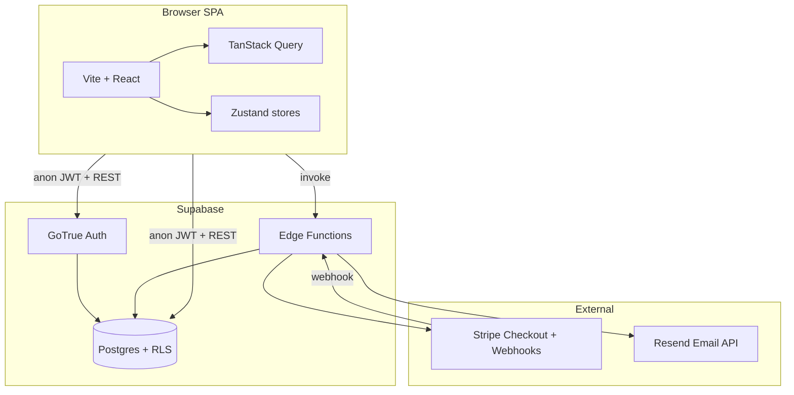

# Architecture

## High-level diagram



## Frontend structure

```
src/
├── pages/           # Landing, Booking, Dashboard, Admin, Login, Confirmation
├── components/      # UI primitives, layout, booking wizard, admin panels
├── services/        # Supabase queries, Stripe checkout invoke, auth
├── stores/          # authStore, bookingStore (persisted wizard)
├── hooks/           # useAuth, useBooking, useAdminDashboard, useToast
├── router/          # React Router 7, lazy routes, ProtectedRoute
├── utils/           # validators, formatters, bookingWizard, bookingValidation
└── types/           # booking, vehicle, payment, user
```

### Routing

| Path | Guard | Page |
|------|-------|------|
| `/` | — | Landing |
| `/login` | — | Login / sign-up |
| `/book` | Authenticated | Booking wizard |
| `/dashboard` | Client role | My bookings |
| `/admin` | Admin role | Operations dashboard |
| `/confirmation/:id` | — | Post-checkout summary |

`ProtectedRoute` reads `authStore` and `profiles.role` to enforce access.

### State management

- **Server state:** TanStack Query with keys in `QUERY_KEYS` (`constants.ts`). Invalidated on mutations; cleared on logout (bookings, admin, vehicles caches).
- **Auth session:** `authStore` synced from Supabase `onAuthStateChange` via `AuthBootstrap`.
- **Booking wizard:** `bookingStore` persisted to `localStorage` key `velox-booking-wizard-v4` — holds draft, step, `checkoutBookingId`, fingerprint, `wizardOwnerId` (prevents cross-user leakage). Reset on sign-out and account switch.

### Key services

| Module | Responsibility |
|--------|----------------|
| `bookingService.ts` | CRUD bookings, admin list/assign, overlap checks, email invoke helpers |
| `stripeService.ts` | `create-checkout-session` invoke, payment status reads |
| `authService.ts` | signIn, signUp, profile fetch/update |
| `driverService.ts` / `adminKpiService.ts` | Admin fleet and metrics |

Validation for drafts is centralized in `bookingValidation.ts` (`assertDraftPersistable`, `formatPostgrestError`).

## Backend (Supabase)

### Tables (core)

- `profiles` — 1:1 with `auth.users`, role and contact info
- `vehicles` — fleet catalog and pricing
- `bookings` — reservations with status machine
- `payments` — Stripe payment intent linkage (one active payment per booking enforced by migration)
- `company_drivers` — admin driver roster (see migrations)

### Row Level Security

RLS policies restrict:

- Clients to their own bookings and public vehicle catalog
- Admins to operational tables via `profiles.role = 'admin'`
- Payment writes primarily via **service role** in Edge Functions

Migrations under `supabase/migrations/` are applied in timestamp order; use `npm run db:push` when linked to a project.

### Edge Functions

| Function | JWT verify | Role |
|----------|------------|------|
| `create-checkout-session` | yes | Build Stripe Checkout Session for a pending booking |
| `stripe-webhook` | no | Verify Stripe signature; confirm booking; insert payment |
| `send-email` | no* | Resend templates (DB webhook secret or admin JWT) |

\* `verify_jwt = false` in `config.toml`; function implements its own auth (webhook secret or admin user JWT).

## Payment flow (detailed)

1. Client creates/updates **pending** booking with estimated price.
2. `startHostedStripeCheckout` invokes `create-checkout-session` with `bookingId`, `customerEmail`, `currency`, `appOrigin`.
3. Edge Function validates booking (pending, price, ownership), creates Stripe Checkout Session with metadata `bookingId`.
4. Browser redirects to Stripe; user pays.
5. Stripe sends `payment_intent.succeeded` to `stripe-webhook`.
6. Webhook uses **service role** to:
   - Upsert `payments` row
   - Set booking `status = confirmed`, `final_price` from PI amount
   - Optionally send receipt email via Resend (inlined in webhook handler)

**Note:** Checkout Sessions may not expose `payment_intent` until completion; confirmation is webhook-driven, not client-polling.

## Email flow

| Trigger | Mechanism |
|---------|-----------|
| DB change webhook | POST to `send-email` with `BOOKING_EMAIL_WEBHOOK_SECRET` |
| Admin “notify client” | Client invokes `send-email` with user JWT, `mode: admin_notify` |
| Admin cancellation | `mode: admin_cancel` |

Templates are HTML strings in the Edge Function (Rhodes Chauffeurs branding; site link rodoschauffeurs.gr).

## Security notes

- Only `VITE_*` keys belong in the frontend bundle (Supabase anon/publishable, Stripe publishable).
- `STRIPE_SECRET_KEY`, `STRIPE_WEBHOOK_SECRET`, `RESEND_API_KEY`, service role keys stay in Supabase Edge secrets.
- Admin email invoke validates JWT via `auth.getUser(jwt)` with service role client.
- CORS on checkout/email functions echoes request `Origin` when safe, or uses `ACCESS_CONTROL_ALLOW_ORIGIN`.

## Testing

Vitest runs in Node against pure utilities:

- `src/utils/*.test.ts` — validation, wizard fingerprint, formatters, PDF export

Run: `npm run test` / `npm run test:coverage`

Edge Functions are not unit-tested in-repo; verify via Stripe CLI webhook forwarding and Supabase function logs after deploy.

## Build output

`npm run build` → `dist/` static assets. Configure hosting to:

- SPA fallback to `index.html` for client routes
- Set environment variables at build time for `VITE_SUPABASE_URL`, `VITE_SUPABASE_ANON_KEY`, `VITE_STRIPE_PUBLISHABLE_KEY`
